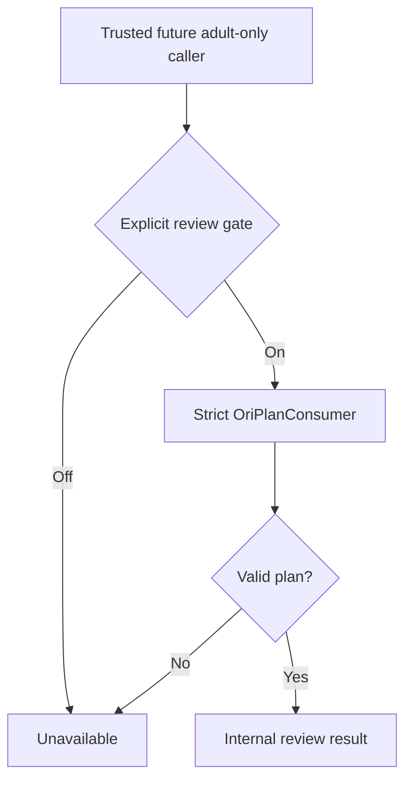

# Ori internal pedagogical plan review boundary

This module is the next **internal-only** stage after cross-repository plan contract tests. It wraps the strict `OriPlanConsumer` with a disabled-by-default gate and returns either a validated plan or `unavailable`.

## Responsibilities

- No request is sent to Ori when the gate is disabled.
- No program is modified and `appliedChanges` is always false.
- Invalid plans, timeouts and transport failures become `unavailable`.
- The plan is intended for **future trusted adult review only**, not a child-facing response.
- This module does not provide authentication, authorization, HTTP endpoints or persistence.

## Safety boundary

Do not wire this module into Kids or the public tutor endpoint. Before exposing it to an adult diagnostics interface, add server-side authorization, CSRF protection, rate limits, audit design and educator review. Keep all changes isolated to `integration/ori`.
