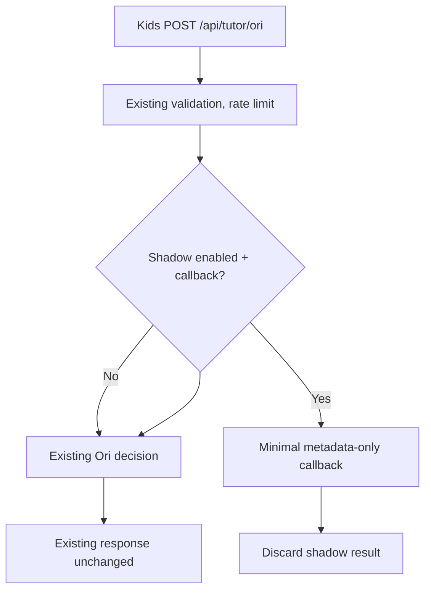

# External Ori shadow boundary — integration stage 1

This introduces a **disabled-by-default**, metadata-only hook in Agorix's existing `apps/tutor-api`. It is not a production Ori connection and does not replace the existing `/api/tutor/ori` response.

## Flag and behavior
`AGORIX_ORI_EXTERNAL_SHADOW=true` sets the feature gate in `main.ts`. **No external callback is wired in main yet**, so setting the flag alone has no network or model effect. An authorized server integration may later inject `oriExternalShadow` via `createTutorServer` options.

When enabled *and* a callback is provided, the existing endpoint asynchronously sends only:
- `missionIndex` (number)
- `hintLevel` (1–5)
- `scriptCount` (number)

No mission ID, child text, program AST, runtime world state, IP, user identity, session or provider credentials are passed. The callback's result is ignored. The current tutor decision and response envelope remain unchanged. Failures must not change the child's experience.

## Remaining work
1. Define an actual trusted transport/adapter between Agorix and `Modern-Ash/ori`, including cancellation and bounded concurrency.
2. Establish host-owned `ProgramProposal` creation, `validateProgramProposal` and `createProposalReview` on synthetic fixtures.
3. Add full server integration tests verifying disabled/enabled behavior and fallback parity.
4. Complete privacy and safeguarding review before sending any child-related context to external models.
5. Keep the existing endpoint response contract and rollback available.

**This stage deliberately cannot apply or propose edits through the external agent.**
