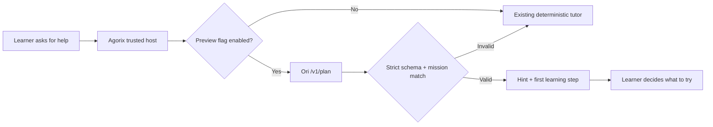

# Ori learner hint preview — first pedagogical consumption boundary

This increment pivots from adult administrative diagnostics toward the intended Ori learner experience: a **small, read-only pedagogical hint** derived from an Ori plan.

## Learning interaction

The preview exposes only `hint` and the first step, not the full plan or any executable action. `requiresLearnerApproval` is true and `appliedChanges` is false. No project files or program state can be modified through this interface.

## Boundaries and next increments

This is **not yet wired to the Kids UI or tutor endpoint**. The feature defaults off. Before enabling it for children, add an age-appropriate content/safety evaluation, contextual relevance checks, educator review, and deterministic fallback on failures. Avoid storing child identifiers, prompts, raw programs or personal data in Ori calls.

The next iteration should exercise this preview with the real Ori process in synthetic missions, then add a separately reviewed learner-facing integration gate. Keep the changes on `integration/ori` only.
