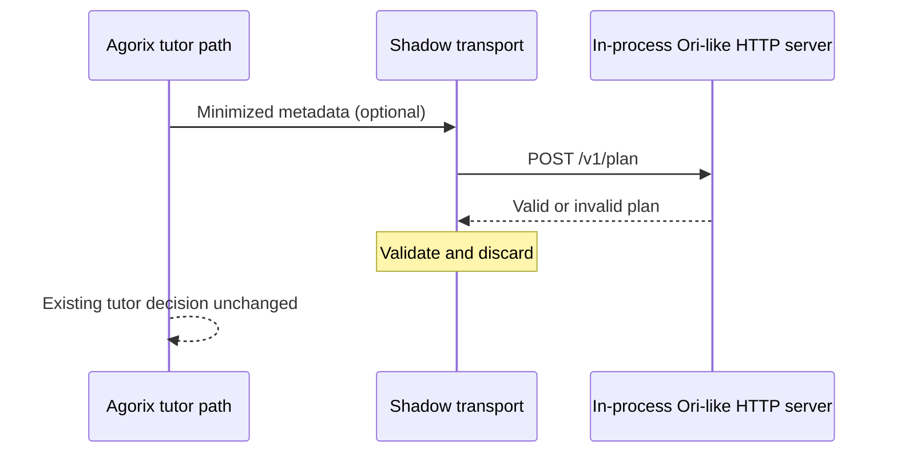

# Ori /v1/plan loopback contract test

## Purpose

Test the Agorix consumer's real HTTP transport against a local in-process server that reproduces Ori's documented `ori/shadow-plan/v1` response. This is **not** a live deployment of both repositories.

## Coverage

- Sends only `missionIndex`, `hintLevel` and `scriptCount`.
- Receives a valid three-step pedagogical plan without returning it to Kids.
- Discards malformed JSON, oversized bodies, unexpected proposals and claims of applied changes.
- Disables external requests when the feature flag is off.
- Keeps the original tutor response independent of transport failure.



## How to run

From the Agorix repository, using its existing workspace dependencies:

```bash
pnpm exec vitest run apps/tutor-api/src/oriShadowLoopbackContract.test.ts
pnpm format:check
pnpm tsc --noEmit
```

## Limitations and next gate

The test server is a synthetic producer and does not start the actual Ori service. A later optional cross-repository smoke test should launch `Modern-Ash/ori` locally and exercise its real `/v1/plan` implementation against this consumer. That step must remain in `integration/ori`, use synthetic metadata only, and never expose responses to children.

Do not promote these changes to `main` or `development` without explicit approval.
