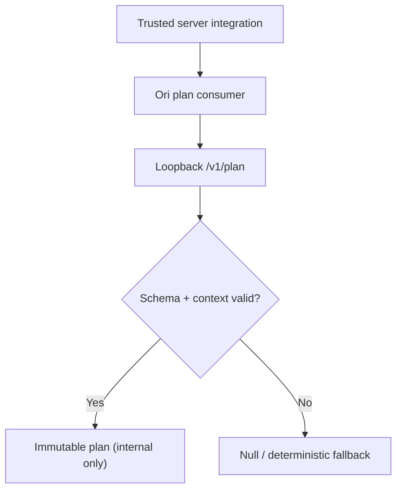

# Ori pedagogical plan consumer — isolated experimental gate

This increment introduces `createOriPlanConsumer` in `apps/tutor-api`, targeting `Modern-Ash/ori`'s `/v1/plan` **only on loopback**.

## Guarantees

- Bounded JSON request with only mission index, hint level and script count.
- 750 ms default timeout, maximum 2 seconds, 4 KiB maximum response.
- Strict `ori/shadow-plan/v1` validation and matching stage/mission context.
- Read-only, immutable returned plan or `null` on any error.
- No child identity, raw text, AST, runtime state, provider key or arbitrary URL.
- No program changes, child-facing API changes, rendering or automatic proposals.



## Integration boundary

This module is intentionally **not wired into the production tutor response**. A future separately reviewed increment must introduce a disabled-by-default flag and explicit host-side policy before any plan is returned to an adult-only diagnostics endpoint. No child-facing rollout is authorized.

## Verification

```bash
pnpm exec vitest run apps/tutor-api/src/oriPlanConsumer.test.ts
pnpm test
pnpm lint
pnpm exec tsc --noEmit
pnpm format:check
```

All checks must pass in `Ori Integration CI`. The private Ori interoperability job must remain mandatory and non-skipping.
