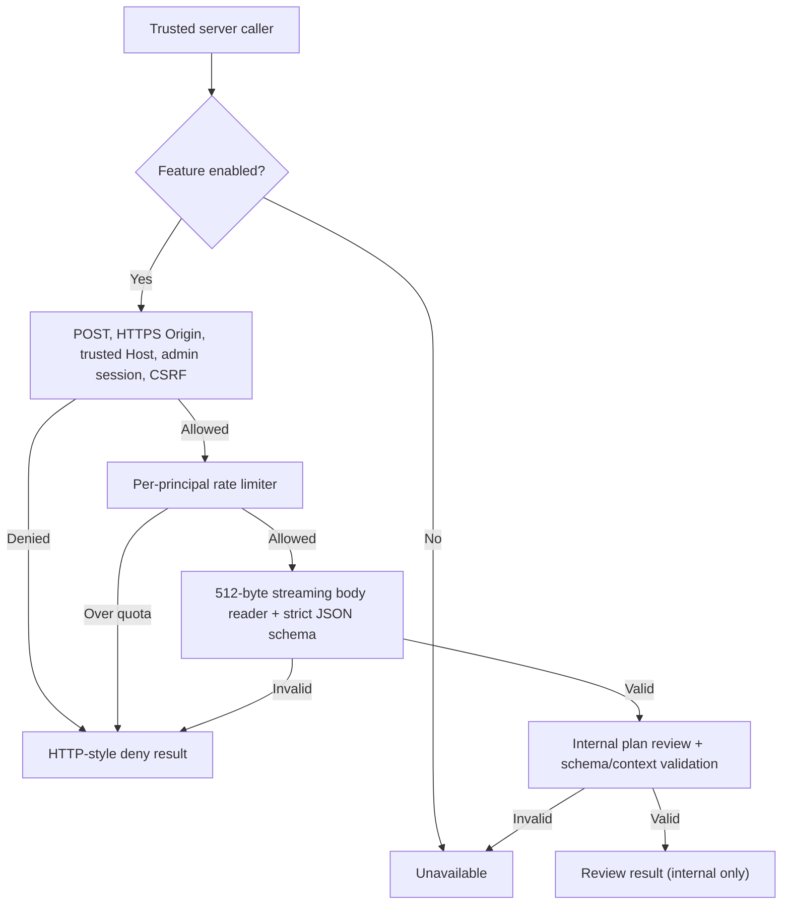

# Ori internal adult review pipeline

This increment composes existing independent security controls into one **unregistered, disabled-by-default** server-side function.

## Constraints

- No HTTP route, public endpoint, Kids response or program modification.
- The gate defaults to disabled and returns unavailable without invoking Ori.
- Session identity is derived from server-side `AdminAuth`, never client JSON.
- The plan is revalidated against the strict schema and requested mission/stage.
- The limiter is process-local, not distributed.

## Before any HTTP exposure

Require trusted reverse-proxy host configuration, explicit adult-only route registration, authentication/CSRF negative tests, request abort handling, HTTP connection cleanup, audit/privacy review and load tests. No deployment is authorized by this PR.

All six Ori Integration CI jobs must pass before merging into `integration/ori`.
