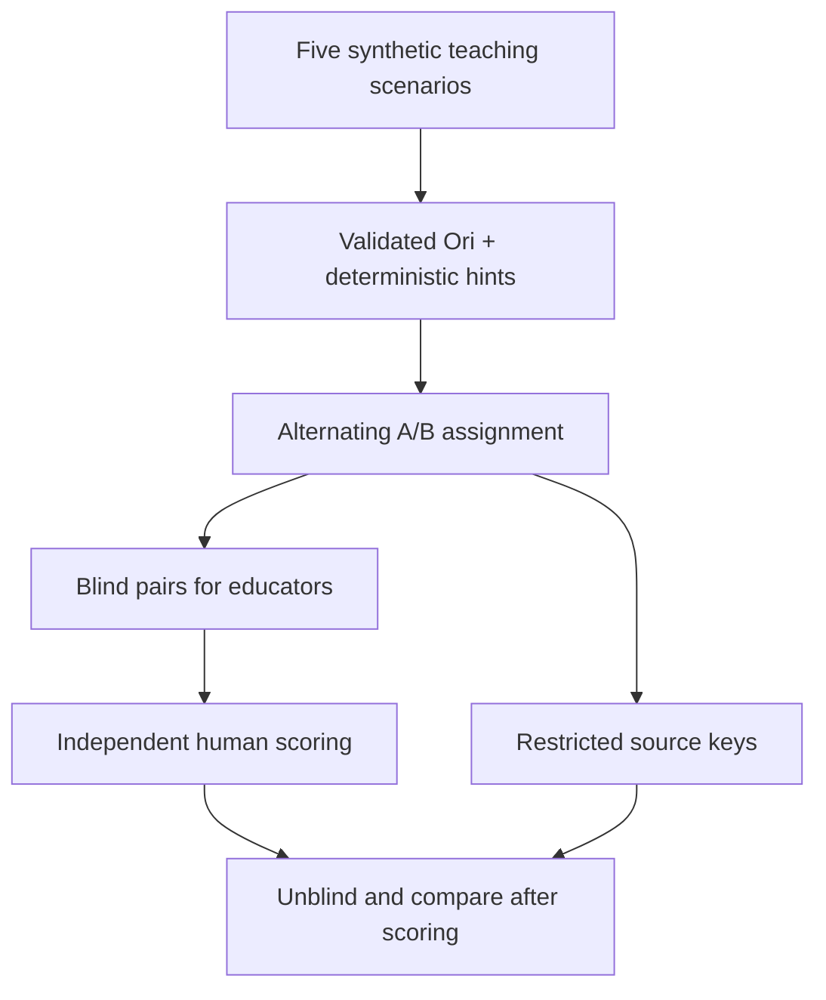

# Ori vs deterministic Agorix tutor — balanced educator evaluation batches

This increment prepares multiple synthetic Scratch-inspired hint comparisons in one batch, alternating Ori between anonymous A and B positions. The coordinator receives two separate arrays: educator-facing `pairs` and restricted source `keys`.

## Protocol

- Use the same synthetic mission and hint level for both candidates.
- Prepare valid hint and next-step text before batching.
- Alternate the source assignment A/B by fixture index.
- Use the inverse assignment for a second independent batch if counterbalancing across reviewers is needed.
- Keep `keys` inaccessible to educators until they have submitted their ratings.

## Limitations

Alternation is deterministic, not random. This implementation does not collect ratings, store evaluation sessions, authenticate educators, or calculate inter-rater agreement. It does not prevent a trusted caller from accidentally exposing the source keys; the caller must enforce that boundary.

No Kids API/UI, child data or program modifications are introduced. All six CI jobs must pass before merging into `integration/ori`.
