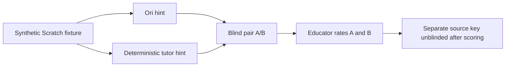

# Ori vs Agorix — blinded hint comparison pairs

This increment prepares two bounded pedagogical responses for the same synthetic fixture: an Ori hint and a deterministic Agorix tutor hint. The educator-facing `pair` contains only labels A and B, the fixture identifier and topic. The source mapping is returned separately as a `key` and must be withheld from raters until scoring is complete.

## Usage constraints

- The caller must obtain both responses from the same mission and hint level and validate each before creating a pair.
- The `oriFirst` flag is provided by the evaluation harness; randomization, counterbalancing and storage are not implemented here.
- Never send the `key` to educator-facing interfaces. The current API returns both objects to a trusted caller, so access control is the caller's responsibility.
- This module validates text bounds and prepares immutable copies; it does not assess safety, educational effectiveness or actual child learning.
- Use synthetic fixtures only. No learner identities, source code, or personal data are needed.

No Kids API or UI is enabled. A subsequent iteration should add a batch evaluator with balanced A/B assignment and human-rating collection.
