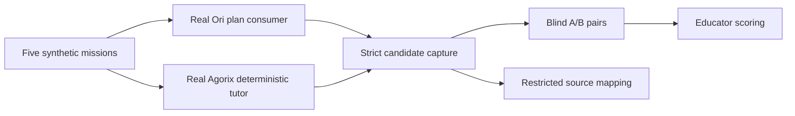

# Ori educator pilot — verified candidate capture

This increment creates a pure offline bridge from five actual Ori plan responses and five separately supplied deterministic Agorix tutor responses into the existing balanced blind A/B batch.

## Workflow

1. Start the Ori reference process on loopback and construct `createOriPlanConsumer`.
2. Obtain real deterministic tutor responses for the exact same synthetic mission and hint level using Agorix's existing tutor interface. Do not fabricate or relabel example text as actual tutor output.
3. Supply the five `{fixtureId, hint, nextStep}` deterministic candidates to `captureOriEducatorCandidates`.
4. The capture function queries Ori for each synthetic fixture, revalidates the contract, and rejects the entire capture if a response is unavailable or mismatched.
5. Keep the returned `batch.keys` restricted to the coordinator; share only `batch.pairs` with educators for blind scoring.

## Current limitations

The function does not itself call the deterministic tutor or provide a command-line runner. The coordinator must supply authentic deterministic responses. No outputs are persisted, no personal data is collected, and no Kids API/UI is enabled. A follow-up should add a verified deterministic-tutor adapter and a CLI for exporting educator-facing pairs separately from the source keys.

This is a technical evaluation harness, not evidence of educational quality or approval for child rollout.
