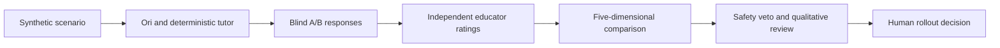

# Ori vs Agorix tutor — educator comparison protocol

## Purpose

Determine whether Ori's hints better support children's programming learning than Agorix's deterministic tutor, without confusing contract validity with teaching quality. This is a protocol for **human assessment**, not a claim that Ori is already superior.

## Blind evaluation

For each synthetic Scratch-inspired fixture (movement, sequence, loops, events and debugging), prepare two responses: one from Ori and one from the deterministic Agorix tutor. Randomize A/B assignment and hide source identity from educators. Preserve the fixture, mission stage and hint level. No real child data is required.

Each educator independently scores both candidates from 1 (poor) to 5 (excellent) on:

| Dimension | What to assess |
| --- | --- |
| Clarity | Can a learner understand the hint? |
| Learner agency | Does it preserve the child's opportunity to decide? |
| Scaffolding | Does it offer an appropriate next step without doing the work? |
| Context relevance | Does it address the actual programming concept? |
| Age appropriateness | Is the wording suitable for the intended learning stage? |

Educators must provide a rationale and independently flag unsafe content. A safety flag prevents the candidate from being considered eligible for rollout regardless of its average score.

## Review workflow

## Scientific limits and next steps

The arithmetic mean is a descriptive score, not evidence of learning outcomes. Recruit multiple educators, pre-register the rubric, record disagreements and assess inter-rater agreement. Compare paired scores by fixture and dimension, not just an overall mean. Actual learning effectiveness requires a separately designed, ethically reviewed learner study.

The current code validates and summarizes **provided human ratings only**. It does not collect educator ratings, invoke LLMs, perform automatic A/B assignment or establish child safety. No Kids endpoint or UI is enabled.
