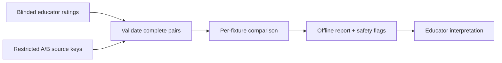

# Ori vs Agorix: reproducible offline educator report

This increment aggregates existing blinded A/B human ratings across multiple synthetic teaching fixtures. It uses the existing paired-rating comparison and only unblinds via restricted source keys **after ratings are complete**.

## Inputs and outputs

Inputs: a bounded set of source keys and complete educator submissions. Each fixture must have paired A/B ratings from each reviewer. Unknown fixture IDs, missing pairs, duplicate keys and invalid ratings reject the entire report rather than silently omitting evidence.

Outputs: per-fixture mean scores and differences by five pedagogical dimensions, total paired reviews and an aggregate safety flag. No source keys, rationales or reviewer IDs are included in the returned report.

## Limitations and next iteration

This is a pure in-memory function, **not** a registration endpoint, database, user interface or CSV/JSON import utility. An evaluation coordinator must collect ratings securely and supply validated data. The report is descriptive and does not establish statistical significance, learning gains, inter-rater agreement or child safety. Do not use real child identifiers.

Next: implement a strictly validated offline import format and reproducible CLI report export, without adding Kids routes or storing personal data.
