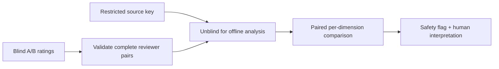

# Ori vs Agorix — paired educator rating analysis

This increment analyzes synthetic or externally collected **complete blinded A/B ratings** for one teaching fixture. The source key is supplied only to the offline analysis step, after reviewers finish rating both candidates.

## Output

- Number of independent reviewers with complete A/B pairs.
- Ori and deterministic tutor mean ratings.
- Difference (Ori minus deterministic tutor) overall and across clarity, learner agency, scaffolding, context relevance and age appropriateness.
- Safety flag if any educator marked either candidate unsafe.

## Limitations

This is descriptive analysis, not a statistical significance test or proof of learning effectiveness. It does not collect, store or authenticate submissions. Reviewer identifiers must be synthetic or pseudonymous and must not encode children's data. A safety flag is not erased by high scores. Before a learner rollout, recruit multiple independent educators, assess agreement, review qualitative rationales and evaluate real learning outcomes under appropriate safeguards.

No Kids API/UI or deployment is introduced.
