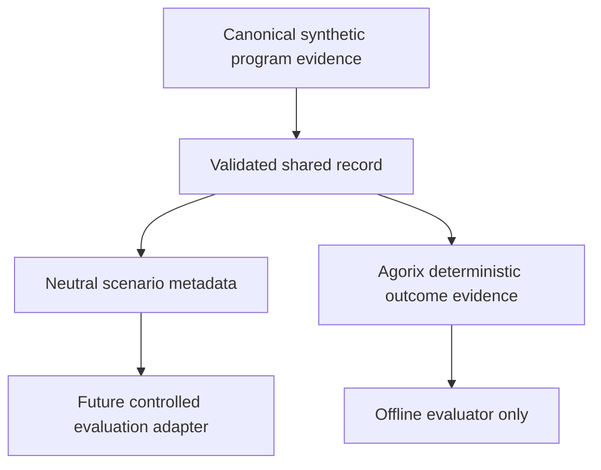

# Ori — neutral context and tutor-specific evidence separation

This increment follows the merged #703 shared synthetic context. The old shared record contained `deterministicKind`, which describes Agorix's rule outcome and could leak an answer to Ori if used as common model input.

## New separation

The neutral record includes mission ID/index, hint level, script count and program fingerprint. The restricted evidence record contains the actual deterministic outcome kind. The neutral record never contains the deterministic answer, program source, child identity or private prompt.

## Important limits

This module only separates in-memory records. It does not transmit neutral context to Ori, nor establish identical input conditions. The current Ori shadow API still accepts mission index, hint level and script count; the deterministic tutor uses the actual mission and program. A program fingerprint is a reproducibility marker, not program semantics.

Next: build an explicit alignment matrix showing which canonical missions can be compared and what evidence is missing for each, before designing a new transport. No Kids API/UI, production rollout or stable branch changes.
