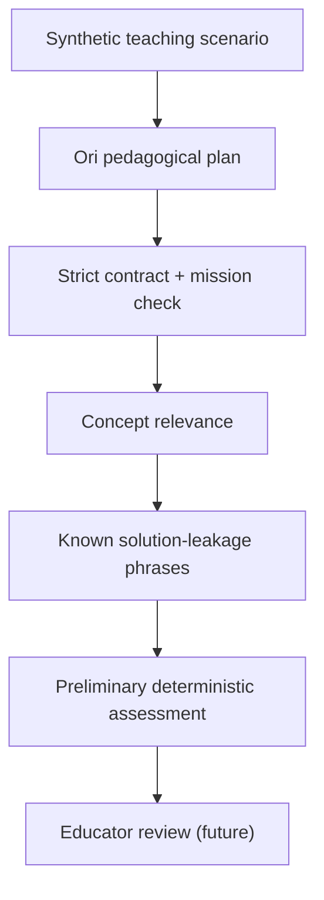

# Ori pedagogical evaluation — first reproducible rubric

Ori is an educational programming agent, not an automatic answer generator. This increment introduces five synthetic, Scratch-inspired evaluation fixtures: movement, sequence, loops, events and debugging.

## Evaluation model

The automated rubric checks valid contracts, mission and hint level, presence of at least one topic concept, and known forbidden solution phrases. It returns explicit reasons for rejection. It is intentionally conservative and reproducible.

## Scientific and pedagogical limitations

Keyword matching cannot establish pedagogical quality, child safety, age appropriateness, cognitive load, genuine scaffolding, accessibility, or whether a hint reveals a solution indirectly. Passing this rubric is **not approval for child use**.

The next iteration should collect educator-rated examples with a rubric for scaffolding, learner agency, contextual accuracy, language and safety, and compare Ori outputs against the deterministic Agorix tutor. No child personal data should be collected for evaluation.

No Kids endpoint or UI is enabled by this increment.
