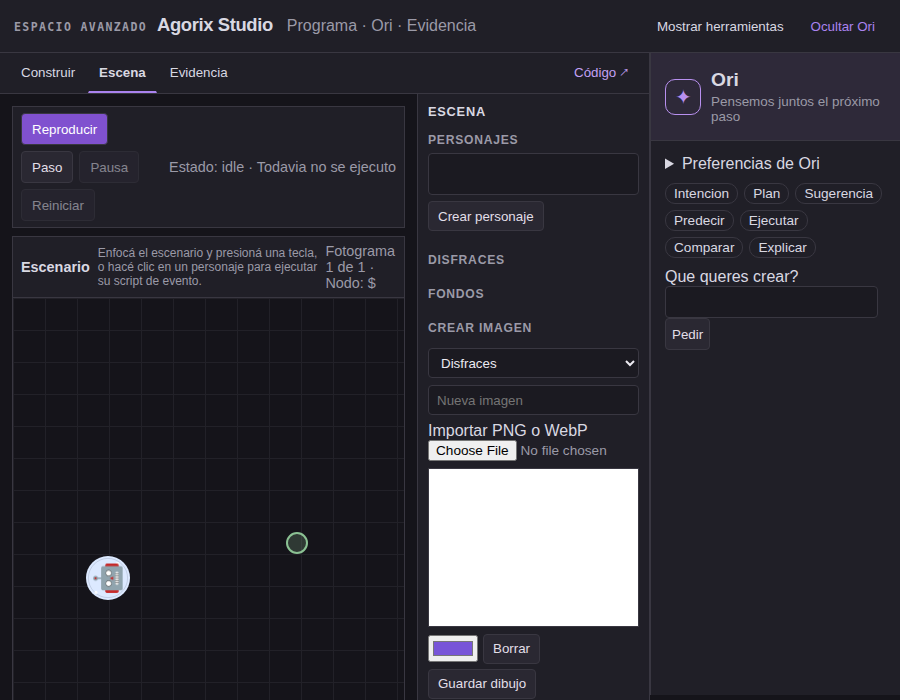

# Studio visual workspace — first slice of #1694

Studio is an IDE for advanced learners. Its layout follows the editor-centered structure of Kiro: a compact tool area, a dominant working editor, and a persistent assistant dock. The content remains Agorix-specific: canonical blocks, deterministic stage and evidence, and Ori as a learning companion.

## Layout and behavior

| Area       | Build                                                          | Scene                                                      | Evidence                   |
| ---------- | -------------------------------------------------------------- | ---------------------------------------------------------- | -------------------------- |
| Left tools | Visual block palette and search                                | Collapsed to free drawing space                            | Available on demand        |
| Center     | Runtime stage and canonical block program                      | Runtime stage beside character, costume and backdrop tools | Runtime stage and evidence |
| Right dock | Ori                                                            | Ori                                                        | Ori                        |
| Code       | Opens the existing synchronized projection in a VS Code editor | Same                                                       | Same                       |

Tools and Ori can each be hidden from the header without discarding the current workbench state. The center tabs switch views without creating a second program model. At 900 × 700 the Scene tools sit beside the stage; at 1440 × 900 the editor has additional room. Below 700 px the Scene tools stack under the stage. All colors use VS Code theme tokens.

## Review captures

These captures use a local synthetic host with a sample canonical program and runtime frame. They show layout at the target viewport sizes, not a full VSIX journey.

| View  | 900 × 700                                                | 1440 × 900                                                 |
| ----- | -------------------------------------------------------- | ---------------------------------------------------------- |
| Build |  |  |
| Scene |  |  |

## Follow-up within #1694

The next slice should replace the remaining basic forms in the Scene editor with visual asset cards and a drawing toolbar, then verify the whole journey in a real VSIX: choose a character, edit a costume, drag a block, run the stage, ask Ori, and inspect evidence. Ori's proposals must continue through learner preview and explicit acceptance before canonical mutation.
