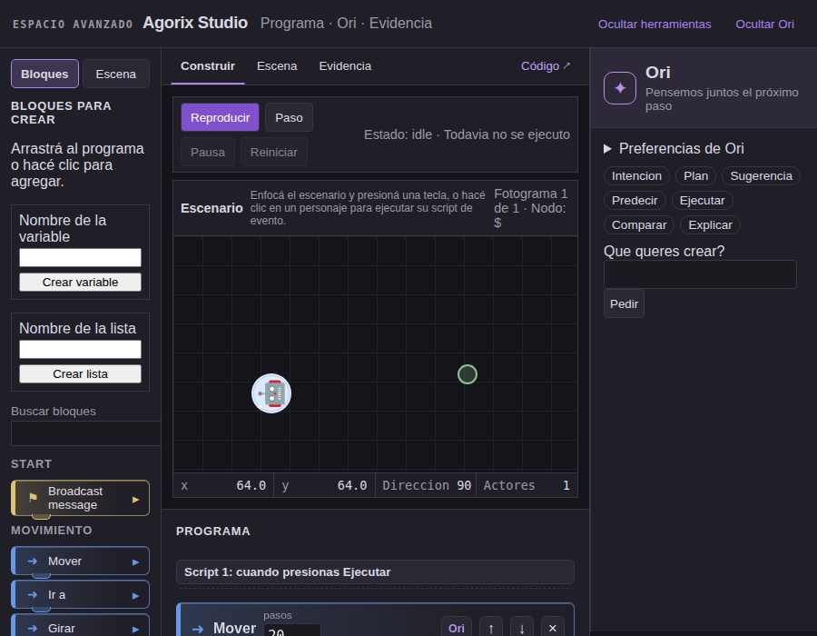
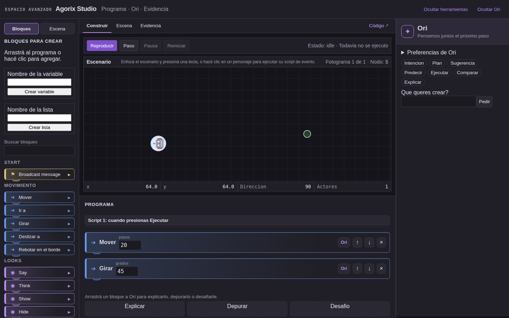

# Studio visual workspace — #1694

Studio is an IDE for advanced learners. Its layout follows the editor-centered structure of Kiro: a compact tool area, a dominant working editor, and a persistent assistant dock. The content remains Agorix-specific: canonical blocks, deterministic stage and evidence, and Ori as a learning companion.

## Layout and behavior

| Area       | Build                                                          | Scene                                                      | Evidence                   |
| ---------- | -------------------------------------------------------------- | ---------------------------------------------------------- | -------------------------- |
| Left tools | Visual block palette and search                                | Collapsed to free drawing space                            | Available on demand        |
| Center     | Runtime stage and canonical block program                      | Runtime stage beside character, costume and backdrop tools | Runtime stage and evidence |
| Right dock | Ori                                                            | Ori                                                        | Ori                        |
| Code       | Opens the existing synchronized projection in a VS Code editor | Same                                                       | Same                       |

Tools and Ori can each be hidden from the header without discarding the current workbench state. The center tabs switch views without creating a second program model. At 900 × 700 the Scene tools sit beside the stage; at 1440 × 900 the editor has additional room. Below 700 px the Scene tools stack under the stage. All colors use VS Code theme tokens.

The Scene editor now groups actors, costumes, backdrops and image creation into visible tabs. Counts show available objects, selected cards show the current actor or asset, and a shortcut in costume/backdrop galleries opens image creation with the matching type selected. Switching galleries preserves the drawing canvas and current form state.

Image creation leads with a 160 × 120 drawing canvas and a two-row toolbar that fits a 900 px viewport. The learner can choose brush or eraser, ink color and stroke size, undo up to 12 edits, clear, and save a validated local PNG. Import remains restricted to bounded PNG/WebP data. A drawing is submitted as an asset only after the learner chooses Save; the canonical program is never changed by pointer movement alone.

## Review captures

These captures use a local synthetic host with a sample canonical program, two actors, assets and a runtime frame. They show layout at the target viewport sizes, not a full VSIX journey.

| View     | 900 × 700                                                      | 1440 × 900                                                       |
| -------- | -------------------------------------------------------------- | ---------------------------------------------------------------- |
| Build    |        |        |
| Scene    |        |        |
| Costumes |  |  |
| Drawing  |    |    |

## Packaged VSIX verification

The installed-extension suite in `extensions/vscode/test/integration/index.cjs` now opens a project with two actors, two costumes, a backdrop, a visible variable and a condition containing a repeat. Against a packaged VSIX in a clean VS Code profile, it checks the code projection, deterministic execution frames and evidence, a read-only Ori explanation, a proposal diff, explicit rejection with unchanged project bytes, and explicit acceptance with the canonical project saved. The Inspector's flat tree now supports VS Code's reveal contract, which this run exposed.

The local run used VS Code 1.146 via `VSCODE_EXECUTABLE=/usr/share/code/code pnpm --filter agorix-studio test:vsix` and passed all 18 integration cases. This is host-level verification of the installed extension. It does not exercise pointer drag, canvas drawing in the actual VS Code window, or Web reopening, and it does not replace the synthetic viewport captures above with real-window captures.

## Follow-up within #1694

The next slice should automate the remaining visible VSIX interactions: choose a character, create a costume, drag a block, run the stage, inspect evidence, and reopen the saved project in Web. Capture the real VS Code window at 900 × 700 and 1440 × 900, then fix observed dead ends. Editing an existing image remains a separate asset workflow gap. Ori's proposals must continue through learner preview and explicit acceptance before canonical mutation.
