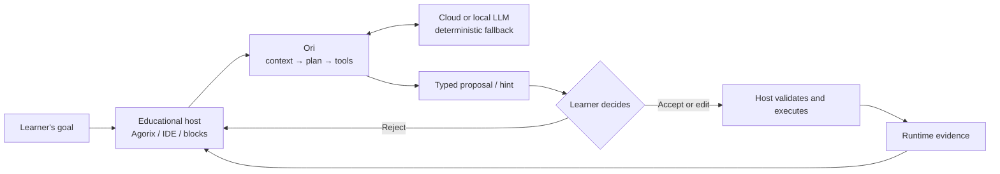
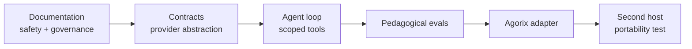

# Ori — Educational coding agent

**Headless · multi-LLM · host-independent · learner-centered**

Ori is an educational coding-agent project inspired by the *workflow* of Codex and Claude Code: understand a goal, inspect context, plan, use tools, evaluate evidence, and propose changes. Unlike a general coding assistant, Ori is designed to **increase a child's programming autonomy**, not silently complete their work. [Agorix](https://github.com/Modern-Ash/agorix) is its first host, not its only host.

> **Mission:** Children should learn to create, predict, debug, question and improve software with AI — while keeping control of their work.

## At a glance
| Ori owns | Host owns |
|---|---|
| Agent loop and planner | UI, avatar and accessibility |
| Multi-model provider adapters | Project persistence and user identity |
| Authorized tool orchestration | Canonical program model and runtime |
| Pedagogical hints and explanations | Consent, final edit and authoritative test results |
| Bounded, reviewable proposals | Curriculum and learning evidence storage |

## A learning example
A child says: **“Quiero que mi zorro salte tres veces.”** Ori can ask *“¿Qué parte querés repetir?”*, inspect the permitted program, propose a small editable loop and invite a prediction. The host must confirm that jumping is supported. **The model never claims to have run the program**: only the host runtime provides execution evidence.

## Design principles
1. **Learning over output:** a correct generated program is not proof of understanding.
2. **Agency:** no silent code changes; learner accepts, edits or rejects.
3. **Evidence:** use actual traces, never invented execution.
4. **Scaffolding:** questions and hints before full solutions when appropriate.
5. **Privacy:** no child personal identifiers, images or audio sent to models; no child free text persisted.
6. **Open ecosystem:** local/cloud models and multiple educational IDEs.
7. **Safe tools:** no arbitrary shell, git, filesystem or network in Kids mode.
8. **Honesty:** disclose limitations and support correction.

## Implementation roadmap

## Documentation
| Guide | Purpose |
|---|---|
| [Philosophy](docs/PHILOSOPHY.md) | Educational mission, agency and ethics |
| [Pedagogy](docs/PEDAGOGY.md) | Teaching methods, assistance ladder and scenarios |
| [Methodology](docs/METHODOLOGY.md) | SDD, AI SDLC, tests and release gates |
| [Integrations](docs/INTEGRATIONS.md) | Host-neutral architecture and API examples |
| [Guía didáctica de integración (ES)](docs/USING_ORI_IN_PROJECTS.md) | Tutorial conceptual: Agorix, editores de bloques, IDE y robótica |
| [Open source](docs/OPEN_SOURCE.md) | Licensing decision and community readiness |
| [Related projects](docs/RELATED_PROJECTS.md) | Scratch, Code.org, MakeCode, Blockly and OctoStudio |

## Current status
This is a **design-stage repository**, not yet a runnable coding agent. TypeScript is the proposed first implementation language to reuse existing Agorix contracts. Apache-2.0 is recommended but **not yet formally adopted**; the repository is currently private. See [licensing #31](https://github.com/Modern-Ash/ori/issues/31), [community #32](https://github.com/Modern-Ash/ori/issues/32) and [quickstart #33](https://github.com/Modern-Ash/ori/issues/33). Do not describe it as publicly released open source until those steps are complete.

## References
[Scratch Foundation](https://scratchfoundation.org/learn/learning-library/scratch-creative-learning-philosophy) · [Code.org AI Tutor](https://support.code.org/hc/en-us/articles/40542019587213-AI-Tutor-FAQ) · [UNESCO](https://www.unesco.org/en/articles/guidance-generative-ai-education-and-research)

References indicate inspiration, not endorsement or empirical validation of Ori.
