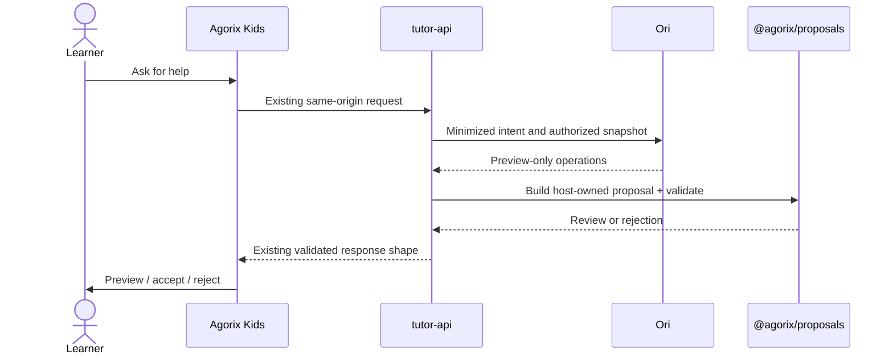

# Ori → Agorix: integration handoff (implementation boundary)

## Verified source contracts
Inspected in `Modern-Ash/agorix`:
- `packages/program-model/src/schema.ts`: `agorix/program/v1`; canonical `move.steps` and `turn.degrees`.
- `packages/runtime/src/execute.ts`: `RunResult.trace` with `step` and `statementType`.
- `packages/proposals/src/index.ts`: `ProgramProposal`, `appendStatement`, `validateProgramProposal`, `createProposalReview`.
- `apps/web/src/kids/kidsOriRemote.ts`: same-origin `/api/tutor/ori` response and mission restrictions.
- `apps/tutor-api/src/server.ts`: existing tutor API and deterministic fallback.

## Why Ori must not manufacture an Agorix ProgramProposal
The full proposal requires `baseProgramHash`, stable IDs, source, purpose, rationale and affected nodes. These are authoritative host-specific fields. Ori can only provide bounded operation **previews**; Agorix must construct and validate the envelope using the current program state.

## Integration order
1. Introduce a server-side adapter behind a disabled-by-default flag; preserve existing `/api/tutor/ori` contract.
2. Map current Agorix program to minimized Ori context; keep project, identity and raw child text out of model calls.
3. Translate Ori `append` preview operations to `appendStatement`, choosing a host-validated script index.
4. Host builds a fresh `ProgramProposal` envelope and runs `validateProgramProposal` and `createProposalReview`.
5. Present existing Kids review flow. Never apply changes on the server or without learner action.
6. Add e2e acceptance/rejection, stale-base, unauthorized block, no-provider, and timeout tests.
7. Enable a small synthetic test cohort, monitor and retain rollback. Real child deployment needs separate safeguarding review.

## Known incompatibilities
- Ori's `move.steps=1` is **not automatically one Kids grid cell**. `kidsOriRemote.ts` requires multiples of `KIDS_GRID.cellSize`; conversion must be made explicitly in Agorix and verified.
- Ori `turn` preview maps to ±90 degrees, but Kids mission eligibility depends on mission index.
- Ori's `ori/proposal/v0` is not the Agorix `ProgramProposal` schema.
- The current Ori host bridge does not advertise `turn` until host-side validation.
- The adapter in this repository is not a deployed connection to Agorix.

## Safety
No raw model-generated program edits, no arbitrary shell/network tools for Kids, no fabricated runtime evidence, no automatic merge/deploy. All tests must use synthetic data until security gates are complete.
