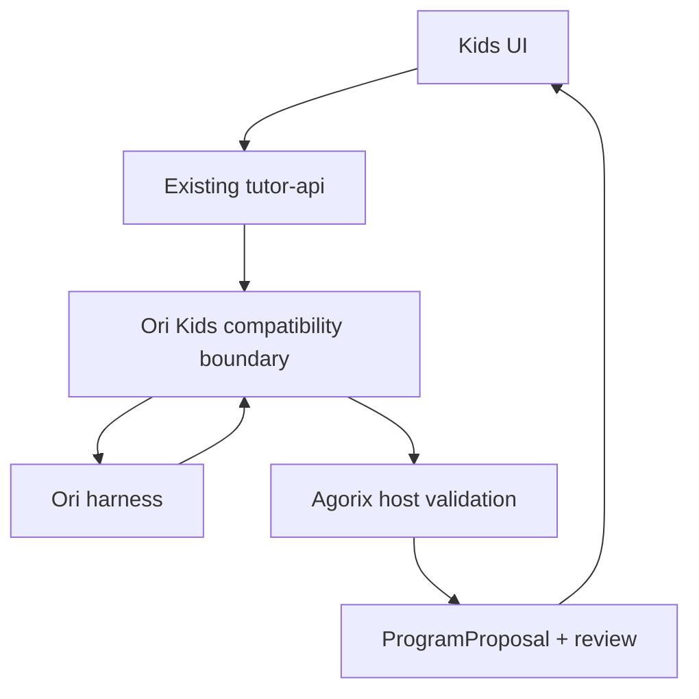

# Agorix Kids compatibility boundary

This is an **integration seam**, not a drop-in replacement for `/api/tutor/ori`.

## Why the boundary exists
Agorix Kids currently calls `/api/tutor/ori` with `missionId`, `locale`, `hintLevel` and a canonical `program`. Its response must contain a complete `ProgramProposal` validated by `@agorix/proposals`. Ori cannot safely fabricate the program hash, IDs, mission eligibility or proposal review state.

The `createAgorixKidsCompatibility` API returns only hints, plans, trace evidence and an **operations preview**. The Agorix host must build and validate the actual proposal.

## Canonical movement units
Ori `move.steps` currently means a *cell count* in the Kids profile. Agorix canonical `move.steps` means pixels. The adapter multiplies by a trusted host-provided `gridCellSize`. The host still validates grid alignment and the mission's allowed block range.

## Security and limits
- Only `move` previews are currently exposed; turns and repeats remain gated.
- No program changes are applied by Ori.
- No direct HTTP endpoint, authentication or child-facing deployment in this module.
- No complete `ProgramProposal` is returned; `needsHostValidation` is explicit.
- No provider calls or persistence are introduced.
- `missionIndex` is validated but **not yet used to authorize operations**; the host must enforce mission restrictions.

## Next steps in Agorix
1. Add a disabled-by-default server-side flag to `apps/tutor-api`.
2. Construct the compatibility boundary from trusted host state, not client-supplied mission metadata.
3. Build a complete `ProgramProposal` with current program hash and stable IDs.
4. Validate using `validateProgramProposal` and `createProposalReview`.
5. Return the existing response envelope and preserve deterministic fallback.
6. Add e2e accept/edit/reject, stale-base, offline and mission restrictions.
