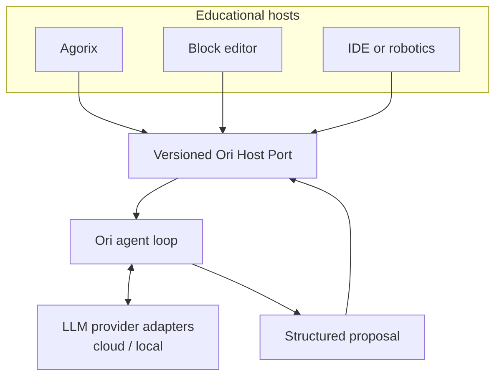
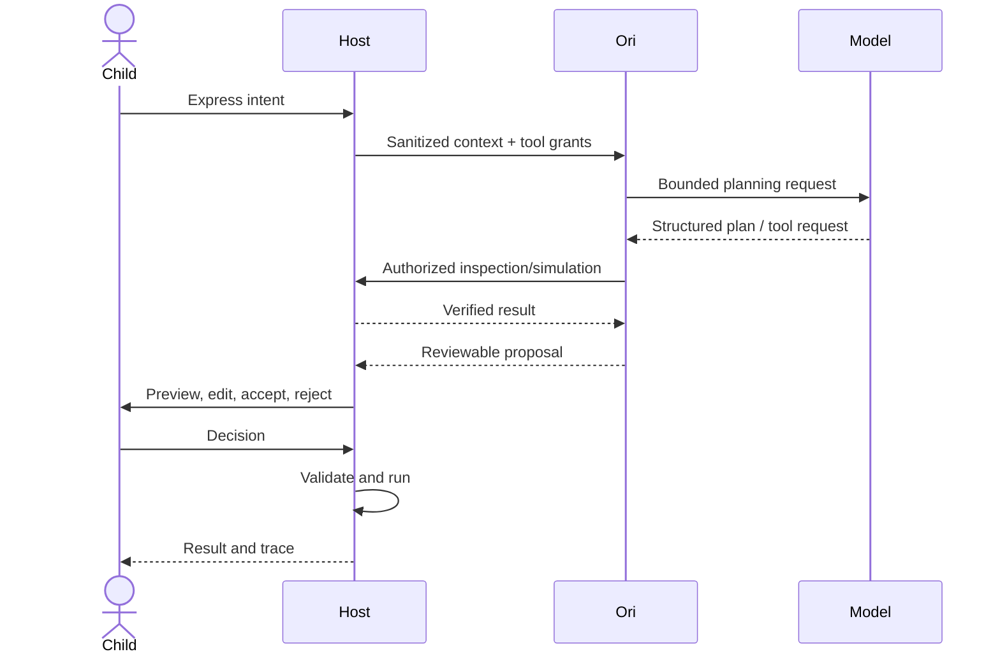

# Integrations — Ori beyond Agorix

## Architectural promise
Ori is **headless**. Agorix is the first adapter, but a block editor, browser IDE, desktop IDE or educational robotics tool should be able to integrate Ori without importing Agorix code. Portability is a hypothesis until a second independent host passes contract tests.



## Ownership and permissions
| Operation | Ori | Host |
|---|---|---|
| Read authorized project snapshot | Requests via port | Grants and sanitizes |
| Plan and explain | Owns | Displays |
| Request bounded simulation | Calls port | Executes authoritative runtime |
| Propose program change | Returns typed diff | Validates and presents |
| Accept or reject | Cannot decide | Child decides through UI |
| Store project/age/identity | Must not | Owns with safeguards |
| Execute shell/network/git | Forbidden in Kids profile | Not exposed |

## Proposed contract (illustrative, not yet implemented)
```json
{
  "schemaVersion": "ori/session/v1",
  "locale": "es-AR",
  "learningStage": "connect",
  "capabilities": ["inspectProgram", "simulateProgram", "proposeDiff"],
  "projectSnapshot": {
    "programVersion": "v1",
    "nodes": []
  },
  "limits": {
    "maxToolCalls": 4,
    "timeoutMs": 3000
  }
}
```

The payload is illustrative; #7 will define normative schemas. Session credentials and sensitive host identifiers must not be included in model prompts. Models receive only the minimum permitted task context.

## Agent-to-host sequence


## Errors and resilience
Invalid schema → reject proposal. Missing capability → explain limitation or deterministic fallback. Provider timeout → return safe bounded guidance. Contradictory runtime evidence → do not assert success. Budget exhaustion → no hidden retries outside policy. Each host must keep core programming functional without Ori.

## Profiles
**Kids:** read/simulate/propose only, small diffs, no shell/git/network. **Studio:** more complex analysis but still host-authorized. **Educator:** aggregates and guidance without child identities. Any future developer profile needs separate security design.

## Portability acceptance
Build a synthetic reference host in addition to Agorix. Run the same fixtures against both: capability negotiation, unauthorized calls, invalid diffs, offline fallback, learner approval and trace grounding. Do not claim compatibility with Blockly, MakeCode or any IDE until an actual adapter is tested.

## References
[Blockly](https://developers.google.com/blockly) · [MakeCode/PXT](https://github.com/microsoft/pxt) · [OctoStudio](https://www.media.mit.edu/projects/octostudio/overview/)
