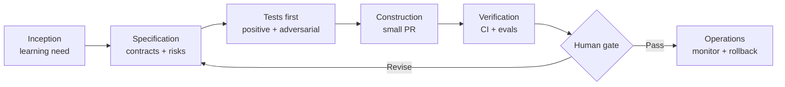
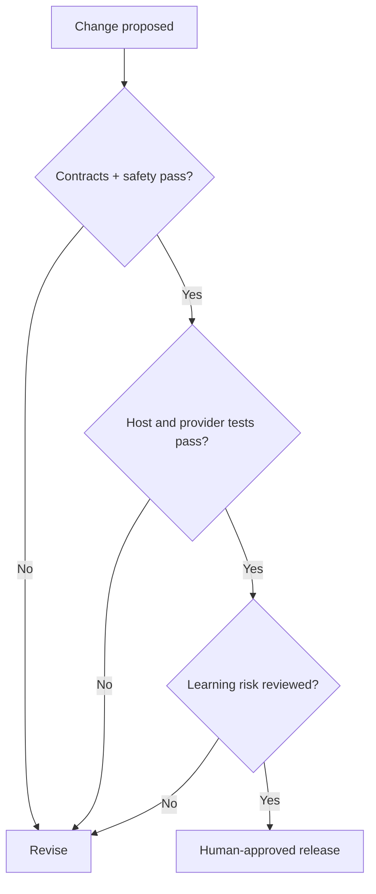

# Methodology — SDD, AI SDLC and educational evidence

Ori requires two kinds of correctness: **engineering correctness** (typed contracts, privacy, tool permissions, cost, latency) and **educational usefulness** (autonomy, understanding, transfer). One does not imply the other.

## Delivery lifecycle

## Definition of Ready
An issue must define the learner problem, scope/non-goals, host vs agent ownership, versioned input/output, permission model, cost/timeout limits, failure/fallback path and measurable acceptance criteria. Avoid “implement a smart tutor” without a testable contract.

## Verification gates
| Gate | Required evidence | Typical failure |
|---|---|---|
| G0 Architecture | ADR and child-safety threat review | Unrestricted tools |
| G1 Contracts | Schema tests and deterministic fallback | Invalid diffs accepted |
| G2 Adversarial | Prompt injection, PII and tool scope tests | Unauthorized tool call |
| G3 Integration | Fake-provider + host contract tests | Vendor or Agorix coupling |
| G4 Pedagogy | Educator review and consented learner session | Child only copies solutions |
| G5 Release | CI, rollback, cost/latency budgets | No recovery from provider outage |

## Example: issue for trace-grounded debugging
**Given:** a synthetic program trace with steps 1–5 and failure at step 3. **When:** Ori explains the failure. **Then:** the explanation must cite step 3 or admit insufficient evidence; it must not fabricate an unseen instruction. Negative cases include missing, contradictory and hostile trace payloads.

## Multi-LLM evaluation matrix
Evaluate each adapter using identical synthetic fixtures: structured-output compliance, tool-call correctness, refusal/safety, latency p50/p95, token/cost budget, fallback and no-provider behavior. A high benchmark score does not prove educational benefit.

## AI SDLC workflow for code agents
Read README and AGENTS.md, inspect specs, write tests before implementation, keep PRs small, execute lint/typecheck/unit/contract/evals, document assumptions and known limitations. **Never self-merge.** Use human approval for security-sensitive changes and cutover.

## Documentation is a deliverable
Every behavior change updates API schemas, examples, pedagogy rationale, security implications, and relevant ADR. Prefer reproducible examples with fake providers and no paid credentials. No learner messages, recordings or identity data in fixtures.

## Research references
[Scratch creative learning](https://scratchfoundation.org/learn/learning-library/scratch-creative-learning-philosophy) · [UNESCO guidance](https://www.unesco.org/en/articles/guidance-generative-ai-education-and-research)
