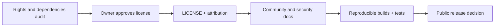

# Open source — Licensing, community and sustainability

## Status: proposed, not yet released
Ori is currently a **private design-stage repository**. The preferred code license is **Apache License 2.0**, but the repository does not yet include a LICENSE file. This document is a recommendation, **not a substitute for an actual license grant**.

## License comparison
| License | Redistribution | Patent terms | Copyleft | Fit |
|---|---|---|---|---|
| MIT | Permissive | No explicit patent grant | None | Simple, less explicit on patents |
| Apache-2.0 | Permissive | Express patent license and termination provisions | None | Recommended for cross-IDE adoption |
| MPL-2.0 | File-level obligations | Express patent terms | File-level | If sharing distributed modifications matters |
| AGPL-3.0 | Strong obligations incl. network use | License-specific provisions | Strong | More constraints for hosted integrators |

**Recommendation:** Apache-2.0 for code after owner approval and rights audit. For original standalone teaching material, consider CC BY 4.0 with an explicit scope statement; keep technical docs Apache-2.0 if simplifying compliance. Never relicense third-party content without permission.

## Adoption checklist

## Open source does not mean a free hosted service
Open code can integrate paid models, but must also support a no-provider deterministic baseline and, where technically feasible, open/local models. Provider API terms, model weights, datasets, assets and fonts have separate licenses. No project should promise zero cost without measuring hardware and operations.

## Community governance
- **CONTRIBUTING:** setup, testing, small PRs, docs expectations, reviewer process.
- **CODE_OF_CONDUCT:** safe participation and moderation.
- **SECURITY:** private vulnerability reporting, child-safety escalation, disclosure handling.
- **ADRs:** record decisions and rejected alternatives.
- **Releases:** changelog, compatibility policy, signed artifacts when feasible.
- **Research:** synthetic public eval fixtures, reproducible methods and clear limitations.

## Rights and safety audit before publication
Check commit history for secrets, children’s data, copyrighted media, unlicensed dependencies, model prompts and external assets. Review contributor rights, NOTICE requirements and trademark use. Publication must not expose child identities or private research data.

## Why permissive licensing here?
Ori should be integrable by public schools, nonprofits, open-source projects and commercial educational platforms. Apache-2.0 permits this while providing explicit patent terms. It does **not** force downstream modifications to be open.

## Work tracking
[License #31](https://github.com/Modern-Ash/ori/issues/31) · [Community #32](https://github.com/Modern-Ash/ori/issues/32) · [Docs #33](https://github.com/Modern-Ash/ori/issues/33) · [Documentation epic #36](https://github.com/Modern-Ash/ori/issues/36)

## Primary sources
[Apache license](https://www.apache.org/licenses/LICENSE-2.0) · [OSI open source definition](https://opensource.org/osd) · [Mozilla MPL FAQ](https://www.mozilla.org/en-US/MPL/2.0/FAQ/) · [Creative Commons BY 4.0](https://creativecommons.org/licenses/by/4.0/)
