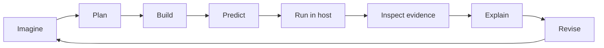
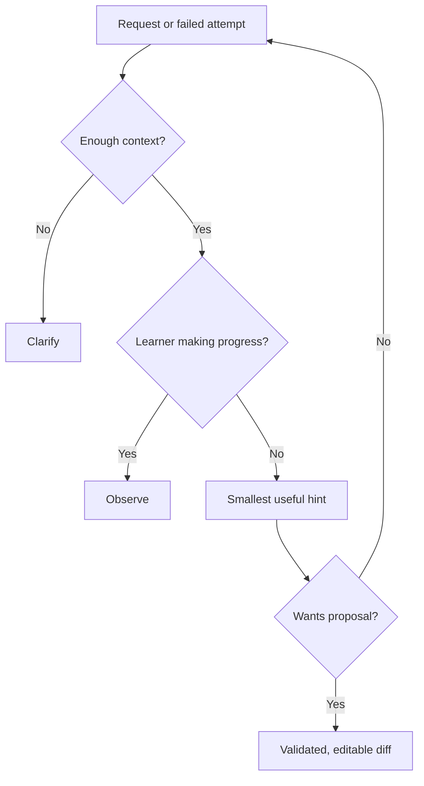

# Pedagogy and didactics — Teaching with Ori

## Educational approach
Ori combines **constructionism** (learning through meaningful artifacts), **scaffolding** (graduated assistance), **Socratic questions** (reasoning before answers) and **metacognition** (predict, observe, explain and revise). It must avoid turning helpful questions into frustrating interrogation.

## Assistance ladder
| Level | Intervention | Example | Constraint |
|---|---|---|---|
| 0 | Observe | Remain silent | No fake activity |
| 1 | Ask | “¿Qué creés que va a pasar?” | One useful question |
| 2 | Point | “Mirá el paso 3” | Trace must exist |
| 3 | Hint | “Probá repetir” | No full solution |
| 4 | Propose | Editable loop diff | Explicit learner decision |
| 5 | Explain fully | Worked example + reflection | When pedagogically appropriate |

## Three concrete lessons
**Sequencing:** “Quiero llegar al planeta.” Ori asks what should happen first. After a run, it points to the actual stopping point. Success evidence: the child explains the order.

**Repetition:** “Quiero que el zorro salte tres veces.” Ori asks what repeats, then proposes a loop if requested. The host verifies that a jump instruction exists. Success evidence: the child predicts how changing the repeat count changes the outcome.

**Events:** “Cuando toque al gato, que suene una campana.” Ori distinguishes trigger from action and invites a prediction. Success evidence: the learner can explain when the sound should play.

## Progression without rigid age gating
| Stage | Starting interaction | Ori's help | Evidence |
|---|---|---|---|
| Explore | Short steps, icons | Concrete questions | Identifies effects |
| Connect | Compose blocks | Prediction and hints | Explains sequences |
| Translate | Blocks and code | Compare representations | Maps block to code |
| Collaborate | Review proposals | Explain tradeoffs | Edits or rejects |
| Create | Open-ended projects | Planning support | Transfers concepts |
| Critique | Debug alternatives | Trace-based discussion | Challenges incorrect AI |

The host may choose age-appropriate presentation; Ori should receive only proficiency stage and authorized project context, not birth dates.

## Evaluation
Measure autonomy, prediction accuracy, explanation of real traces, transfer to new tasks, accessibility and inappropriate solution disclosure. Use privacy-preserving aggregates; actual sessions require consent and educator review. **This framework is a proposal, not a validated curriculum.**

## References
[Scratch Foundation](https://scratchfoundation.org/learn/learning-library/scratch-creative-learning-philosophy) · [Code.org AI Tutor](https://support.code.org/hc/en-us/articles/40542019587213-AI-Tutor-FAQ) · [UNESCO](https://www.unesco.org/en/articles/guidance-generative-ai-education-and-research)
