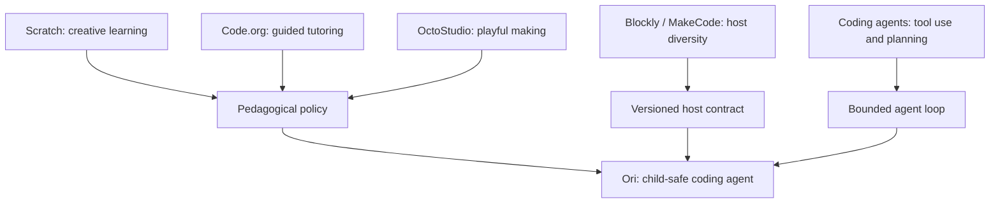

# Related projects — What Ori can learn from the ecosystem

Ori does not attempt to replace Scratch, Blockly, MakeCode or OctoStudio. These are reference environments and educational inspirations, **not confirmed Ori integrations**.

## Comparative map
| Project | Relevant strength | What Ori learns | Not copied |
|---|---|---|---|
| Scratch Foundation / Scratch | Creative learning and meaningful projects | Projects, passion, peers, play and reflection | Scratch UI or branding |
| Code.org AI Tutor | Contextual learning assistance | Questions, hints, debugging support | Product-specific workflow |
| Blockly | Embeddable block-programming infrastructure | Host adapter opportunity | Block rendering engine |
| Microsoft MakeCode/PXT | Blocks-to-text bridge and education | Progressive programming complexity | Proprietary product UX |
| MIT OctoStudio | Playful creation on mobile devices | Low-friction creative activities | Application UI |
| Scratch Tactile | Inclusive, accessible programming | Multimodal learning and accessibility | Physical hardware |
| Codex / Claude Code | Tool-driven coding-agent workflows | Plan, inspect, test and iterate | Unrestricted autonomous edits for children |

## Inspiration → Ori design decisions

## Differentiation hypothesis
Ori aims to combine **multi-LLM choice**, **host-neutral typed tools**, **runtime-evidence-grounded explanations**, **reviewable learner decisions**, and **graduated pedagogical help**. These are goals requiring benchmarks and actual learner studies, not verified comparative advantages.

## How to validate
1. Integrate with Agorix and one independently implemented reference host.
2. Test identical synthetic projects and safety cases across hosts.
3. Ask educators to evaluate hints and conceptual accuracy.
4. Observe consented learner sessions; measure transfer and autonomy.
5. Publish limitations and results without exposing children’s information.

## Source links
- [Scratch creative learning](https://scratchfoundation.org/learn/learning-library/scratch-creative-learning-philosophy)
- [Code.org AI Tutor](https://support.code.org/hc/en-us/articles/40542019587213-AI-Tutor-FAQ)
- [Blockly](https://developers.google.com/blockly)
- [MakeCode/PXT](https://github.com/microsoft/pxt)
- [MIT OctoStudio](https://www.media.mit.edu/projects/octostudio/overview/)
- [Scratch Tactile](https://www.scratchtactile.org/pedagogical-pillars)

All references are independent. No endorsement, integration or measured superiority is implied.
