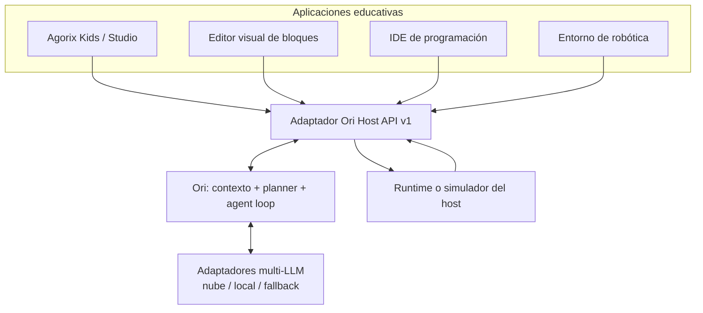
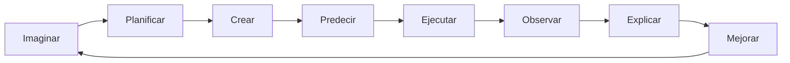
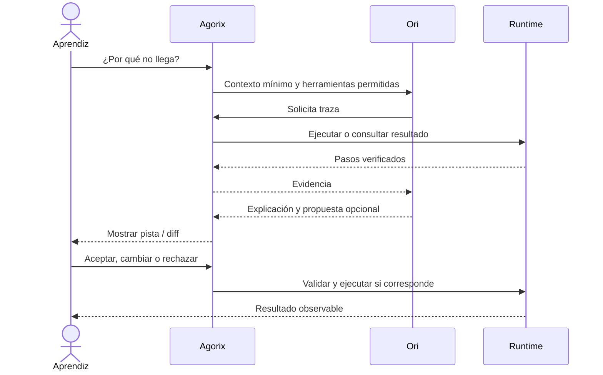
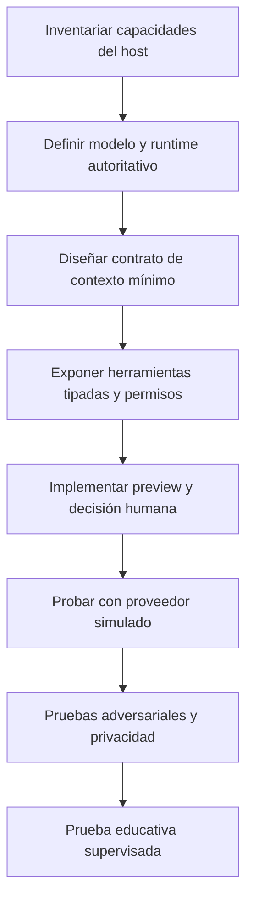

# Guía didáctica: cómo integrar Ori en distintos proyectos educativos

> **Estado:** guía de diseño y adopción. Ori todavía no dispone de un SDK/API ejecutable publicado. Los contratos, ejemplos y nombres de operaciones de este documento son **ilustrativos**, no instrucciones de instalación funcional. Su especificación normativa se desarrolla en [CORE-01](https://github.com/Modern-Ash/ori/issues/7).

## 1. ¿Qué es Ori y para quién es esta guía?

**Ori** es un agente de programación educativo, *headless* y multi-LLM. Su objetivo es acompañar a niños y adolescentes mientras aprenden a construir programas: comprende intenciones, pregunta, planifica, consulta herramientas autorizadas, propone cambios reversibles y explica resultados basados en evidencia.

Esta guía sirve a docentes, desarrolladores de editores infantiles, equipos de robótica, mantenedores de IDE y organizaciones educativas. **Agorix** es nuestro caso de referencia, pero no una dependencia obligatoria.

**Idea central:** el proyecto anfitrión (host) conserva su editor, su modelo de programa, su ejecución y la decisión del alumno. Ori proporciona razonamiento y propuestas; no reemplaza esas responsabilidades.

## 2. Cinco conceptos que conviene distinguir

| Concepto | Explicación para docentes | Responsabilidad técnica |
|---|---|---|
| **Host** | El lugar donde el chico crea | UI, persistencia, permisos y ejecución |
| **Ori** | El compañero que ayuda a pensar | Contexto, planificación, tutoría y herramientas |
| **Modelo (LLM)** | El motor que interpreta lenguaje | Proveedor reemplazable, local o remoto |
| **Herramienta (tool)** | Una acción limitada que Ori puede solicitar | Contrato tipado y permiso otorgado por el host |
| **Evidencia** | Lo que realmente ocurrió al ejecutar | Runtime, simulador o evaluador del host |

### Arquitectura de referencia



**Nota:** este gráfico representa la arquitectura objetivo. No implica que ya existan integraciones con Blockly, MakeCode u otros IDE.

## 3. El recorrido de aprendizaje



La pedagogía se basa en proyectos creativos, andamiaje y reflexión. El objetivo no es que Ori complete más rápido la actividad, sino que el aprendiz pueda explicar, modificar y transferir lo aprendido.

## 4. Tutorial conceptual: Agorix + Ori

### Escenario

Una niña crea una escena con un zorro y quiere que llegue a un planeta. Ya tiene dos bloques de movimiento, pero el personaje se detiene antes de la meta.

**Sin Ori:** el editor permite ejecutar, inspeccionar el resultado y corregir manualmente.

**Con Ori:** la niña pregunta «¿Por qué no llega?». Agorix obtiene una traza real, comparte únicamente la información necesaria y Ori responde «En el paso 2 avanzaste una casilla. ¿Cuántas faltan para llegar?». Si la niña solicita una propuesta, Ori genera un diff que Agorix valida y presenta para aceptar, cambiar o rechazar.

### Paso 1 — Agorix expone capacidades limitadas

Agorix podría ofrecer `inspectProgram`, `inspectScene`, `simulateProgram`, `inspectTrace` y `proposeDiff`. No expone shell, git, red ni acceso general al sistema de archivos.

### Paso 2 — Agorix prepara el contexto

Ejemplo de **contrato propuesto, no implementado**:

```json
{
  "schemaVersion": "ori/session/v1",
  "locale": "es-AR",
  "learningStage": "connect",
  "capabilities": ["inspectProgram", "inspectTrace", "proposeDiff"],
  "projectSnapshot": {
    "programVersion": "example-1",
    "nodes": [
      {"id": "b1", "kind": "move", "steps": 1},
      {"id": "b2", "kind": "move", "steps": 1}
    ]
  },
  "limits": {"maxToolCalls": 4, "timeoutMs": 3000}
}
```

Los identificadores de ejemplo no son datos reales. En producción, el host debe minimizar el contexto, separar credenciales y no enviar datos personales infantiles.

### Paso 3 — Ori razona, pero no inventa resultados

Ori puede pedir `inspectTrace` y explicar un paso observado. Si la traza no existe, debe reconocerlo: «Todavía no vimos qué pasó. ¿Probamos ejecutar?».

### Paso 4 — El chico decide



La aprobación y la aplicación de cambios son siempre del host y del aprendiz; Ori no altera el proyecto unilateralmente.

### Paso 5 — Evaluar si hubo aprendizaje

No basta con que el zorro llegue. Preguntamos: ¿la niña puede explicar qué bloque faltaba?, ¿puede resolver una variante?, ¿pudo rechazar una propuesta incorrecta? La evaluación requiere observación real, no únicamente métricas del modelo.

## 5. Segundo escenario: editor de bloques independiente

Supongamos un editor construido con Blockly. El host conserva su representación de bloques, su generador y su simulador. El adaptador traduce un **snapshot autorizado** a la API de Ori y transforma una propuesta tipada en una vista previa de bloques.

**Actividad:** «Quiero que el personaje gire cuando toque una pared».

Ori identifica los conceptos *evento* y *giro*. Primero pregunta qué debería ocurrir al tocar la pared. Después puede proponer un cambio compatible con las capacidades anunciadas por ese editor.

**Criterio de aceptación:** Ori nunca propone bloques que el host no puede representar; si no hay simulador, no afirma haber ejecutado nada. La integración con Blockly es hipotética hasta que se construya y pruebe el adaptador.

## 6. Tercer escenario: IDE de texto para adolescentes

Un IDE educativo podría permitir Python, Java o TypeScript. El host comparte un árbol de archivos limitado y diagnósticos autorizados; Ori ayuda a interpretar errores, planificar cambios y comparar alternativas.

**Actividad:** un bucle Python imprime una vez menos de lo esperado. Ori consulta el diagnóstico o resultado de prueba del host y pregunta cómo funciona el límite superior de `range`. Puede proponer un diff de pocas líneas para revisión.

**Regla:** en perfiles infantiles no hay terminal arbitraria ni acceso general al repositorio. Un futuro perfil profesional requiere un modelo de amenazas independiente.

## 7. Cuarto escenario: robótica educativa

El host conoce sensores, motores, simulación y reglas de seguridad. Ori podría ayudar a programar un robot para recorrer un cuadrado.

**Primero se simula**, después el alumno revisa y el host decide si habilita el dispositivo físico bajo supervisión. Ori no envía órdenes directamente a motores, cámaras ni actuadores.

En este contexto las políticas de seguridad deben incluir límites físicos, parada de emergencia y control humano adicional. Una integración robótica no se considera segura por reutilizar solamente la política de Kids.

## 8. Cómo construir un adaptador nuevo



### Checklist técnico de integración

- [ ] El host funciona sin Ori ni conexión al proveedor.
- [ ] Las capacidades se anuncian explícitamente y se verifican en cada llamada.
- [ ] Cada tool tiene esquema, límites, permisos y errores tipados.
- [ ] No se comparte identidad, fecha de nacimiento, audio, imágenes ni datos personales con el LLM.
- [ ] El texto libre del chico no se persiste ni se registra en logs.
- [ ] El modelo no ejecuta comandos arbitrarios ni aplica diffs.
- [ ] El host valida el diff y presenta una decisión explícita.
- [ ] Las explicaciones de ejecución se basan en resultados verificables.
- [ ] Existe fallback determinista ante errores, timeout y ausencia de LLM.
- [ ] Las pruebas de contrato y los escenarios adversariales pasan.
- [ ] Se revisan accesibilidad, consentimiento y privacidad antes de usarlo con chicos.

## 9. Elegir proveedor sin depender de uno solo

| Modalidad | Ventajas potenciales | Aspectos a evaluar |
|---|---|---|
| API comercial | Capacidad y disponibilidad de modelos | Costo, privacidad, latencia, condiciones del proveedor |
| Modelo local (p. ej. Ollama) | Mayor control del entorno | Hardware, calidad, mantenimiento |
| Endpoint compatible con OpenCode | Flexibilidad del entorno | Capacidades reales de tools y salida estructurada |
| Sin LLM | Continuidad, pruebas deterministas | Menor flexibilidad conversacional |

No asumir paridad entre modelos. Probarlos con el mismo conjunto de fixtures sintéticos y comparar precisión, seguridad, costo, latencia y cumplimiento de contratos.

## 10. Qué documentar para cada proyecto

Cada adaptador debería incluir un README con propósito educativo, requisitos, capacidades habilitadas, esquema de contexto, políticas de seguridad, ejemplo reproducible sin proveedor pago, pruebas, limitaciones conocidas y proceso de rollback.

Una integración debe distinguir entre **funcionalidad implementada**, **compatibilidad comprobada** y **propuesta futura**.

## 11. Errores frecuentes

| Error | Consecuencia | Alternativa |
|---|---|---|
| Darle a Ori acceso irrestricto al IDE | Riesgo de cambios o filtraciones | Tools mínimas con permisos |
| Enviar todo el proyecto al modelo | Exceso de contexto y exposición | Snapshot reducido |
| Mostrar una solución completa al inicio | Menos oportunidades de aprendizaje | Ayuda gradual |
| Confiar en que el LLM «ejecutó» | Resultados inventados | Runtime autoritativo |
| Acoplar Ori al modelo de Agorix | Imposibilidad de reutilización | Contratos host-neutral |
| Medir éxito por líneas generadas | Confundir productividad con aprendizaje | Autonomía, predicción y transferencia |

## 12. Roadmap para convertir esta guía en tutorial ejecutable

1. Definir esquemas normativos en [Ori #7](https://github.com/Modern-Ash/ori/issues/7).
2. Implementar permisos y registry de herramientas en [#15](https://github.com/Modern-Ash/ori/issues/15).
3. Crear adaptador Agorix en [#28](https://github.com/Modern-Ash/ori/issues/28).
4. Crear segundo host sintético en [#35](https://github.com/Modern-Ash/ori/issues/35).
5. Añadir quickstart reproducible y ejemplos funcionales en [#33](https://github.com/Modern-Ash/ori/issues/33).

**Hasta entonces, los ejemplos de esta guía no deben presentarse como SDK operativo.**

## 13. Lecturas complementarias

- [Ori — Filosofía](PHILOSOPHY.md)
- [Ori — Pedagogía](PEDAGOGY.md)
- [Ori — Metodología](METHODOLOGY.md)
- [Ori — Contratos e integraciones](INTEGRATIONS.md)
- [Scratch Foundation: creative learning](https://scratchfoundation.org/learn/learning-library/scratch-creative-learning-philosophy)
- [Code.org AI Tutor](https://support.code.org/hc/en-us/articles/40542019587213-AI-Tutor-FAQ)
- [Blockly](https://developers.google.com/blockly)
- [Microsoft MakeCode/PXT](https://github.com/microsoft/pxt)
- [UNESCO: generative AI in education](https://www.unesco.org/en/articles/guidance-generative-ai-education-and-research)

Las referencias son inspiración y documentación externa, no certificación, asociación ni evidencia de que Ori ya funciona en esos productos.
