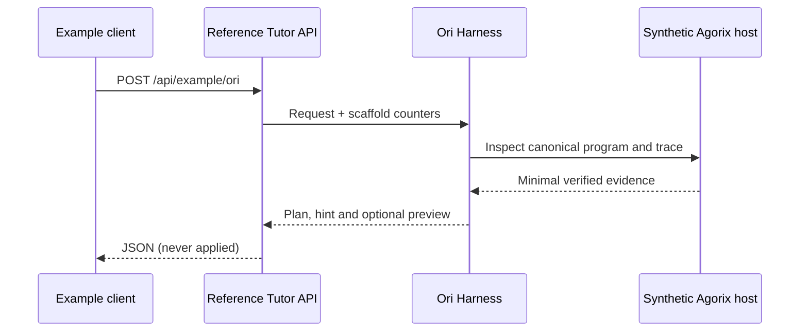

# Reference Tutor API — Ori as a client integration example

This is a **runnable synthetic example** in Ori's repository, not Agorix's production `tutor-api`. It demonstrates how an educational host can call the Ori harness and receive plans, hints, trace evidence and **review-only** operations.

## Run (Node.js >=20)
```bash
npm test
npm run demo:tutor-api
```

The demo starts a loopback server on an ephemeral port, sends one synthetic request and closes. No LLM, API key, browser, user identity or network service is required.

## Contract
`POST /api/example/ori` with JSON:

```json
{"message":"quiero llegar","attempts":2,"hintsUsed":2,"allowProposal":true}
```

The response contains `kind`, `message`, `plan`, `evidence`, `operationsPreview`, `requiresLearnerApproval` and `appliedChanges:false`.



## What is deliberately absent
- No real Agorix project storage or runtime execution.
- No actual `ProgramProposal` envelope, `baseProgramHash` or `createProposalReview` call.
- No authenticated child session, CSRF protection, production rate limits or complete child-safety policy.
- No model provider calls and no direct code edits.

**Do not deploy this example as a public child-facing service.** It binds to loopback only in the demo. The host must enforce authorization, CSRF protections, body/time limits, audit policies and full canonical validation before integration.

## Important differences with Agorix Kids
Agorix's real `/api/tutor/ori` contract uses `missionId`, `locale`, `hintLevel` and `program`, and validates a complete `@agorix/proposals` object. This example uses a deliberately simpler endpoint. A future adapter must preserve the real Agorix contract and explicitly translate Ori movement units to `KIDS_GRID.cellSize` before exposing any proposal.

See [integration handoff](../../docs/AGORIX_INTEGRATION_HANDOFF.md), [contracts](../../docs/INTEGRATIONS.md) and [safety issues](https://github.com/Modern-Ash/ori/issues/23).

## Client SDK demonstration

The new `src/tutor-client.mjs` is a minimal, host-neutral client for the **synthetic** Tutor API endpoint. It validates a loopback-only URL, request bounds, response size and the invariant `appliedChanges:false`.

Run an end-to-end reference roundtrip:

```bash
npm run demo:tutor-client
```

This starts the synthetic server on an ephemeral loopback port, calls it through the client SDK and prints the review-only response. It does not modify a project or contact a model.

The SDK deliberately does **not** target Agorix's production `/api/tutor/ori` endpoint. That protocol requires a separate adapter and security review.
